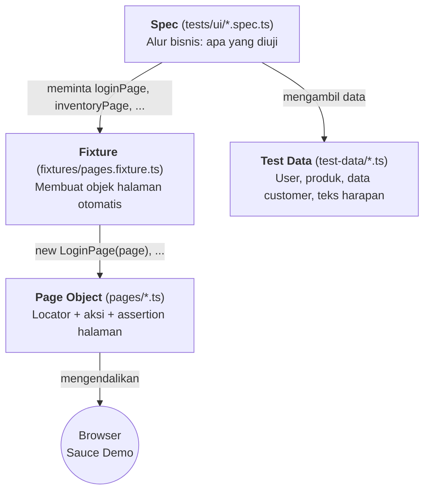
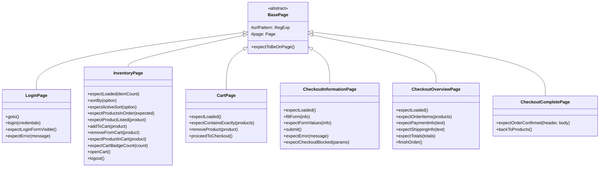
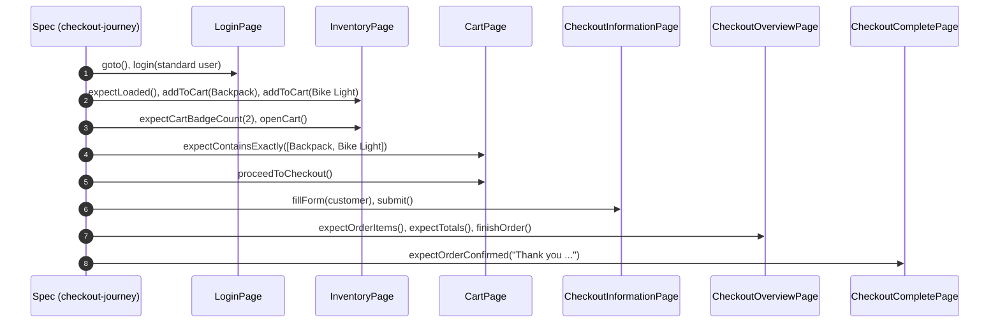

# Page Object Model (POM)

*Terakhir dicocokkan dengan kode: `9a633ea` (2026-11-27)*

Artikel ini menjelaskan bagaimana Page Object Model dipakai di Part A (UI test Sauce Demo).

---

## 1. Apa itu POM, dalam satu kalimat

Setiap halaman web punya **satu kelas** yang menyimpan cara menemukan elemennya (locator), apa yang bisa
dilakukan user di halaman itu (aksi), dan apa yang harus benar di halaman itu (assertion).
Test (spec) tinggal memanggil kelas tersebut dan hanya berisi alur bisnis.

**Manfaat:** kalau tampilan situs berubah, cukup ubah satu Page Object. Semua test yang memakainya ikut benar.

---

## 2. Gambaran besar: tiga lapisan



| Lapisan | Lokasi | Boleh berisi | Tidak berisi |
|---|---|---|---|
| Spec | [`tests/ui/`](../../tests/ui) | Alur dan urutan langkah | Locator, selector |
| Fixture | [`fixtures/pages.fixture.ts`](../../fixtures/pages.fixture.ts) | Pembuatan objek Page Object | Logika test |
| Page Object | [`pages/`](../../pages) | Locator, aksi, assertion halaman | Data test |
| Test Data | [`test-data/`](../../test-data) | Data dan aturan (katalog, user, total order) | Logika browser |

---

## 3. Daftar Page Object



| File | Halaman Sauce Demo |
|---|---|
| [`BasePage.ts`](../../pages/BasePage.ts) | Kelas induk (abstrak). Setiap halaman wajib mengisi `urlPattern`, sehingga otomatis punya `expectToBeOnPage()` |
| [`LoginPage.ts`](../../pages/LoginPage.ts) | Halaman login |
| [`InventoryPage.ts`](../../pages/InventoryPage.ts) | Daftar produk: sort, tambah ke keranjang, logout |
| [`CartPage.ts`](../../pages/CartPage.ts) | Keranjang |
| [`CheckoutInformationPage.ts`](../../pages/CheckoutInformationPage.ts) | Form First Name, Last Name, Postal Code |
| [`CheckoutOverviewPage.ts`](../../pages/CheckoutOverviewPage.ts) | Ringkasan pesanan sebelum Finish. `finishOrder()` dijaga guard write, jadi tidak bisa jalan di prod |
| [`CheckoutCompletePage.ts`](../../pages/CheckoutCompletePage.ts) | Layar "Thank you" |
| [`index.ts`](../../pages/index.ts) | Mengekspor semua kelas di atas dalam satu pintu |

---

## 4. Isi sebuah Page Object

Contoh: `LoginPage` (disederhanakan).

```ts
export class LoginPage extends BasePage {
  protected readonly urlPattern = /\/$/;

  // 1) LOCATOR: didefinisikan sekali di constructor
  readonly usernameInput: Locator;
  readonly passwordInput: Locator;
  readonly loginButton: Locator;
  readonly errorMessage: Locator;

  constructor(page: Page) {
    super(page);
    this.usernameInput = page.getByTestId('username');
    this.passwordInput = page.getByTestId('password');
    this.loginButton = page.getByTestId('login-button');
    this.errorMessage = page.getByTestId('error');
  }

  // 2) AKSI: langkah yang dilakukan user
  async login({ username, password }: Credentials) {
    await this.usernameInput.fill(username);
    await this.passwordInput.fill(password);
    await this.loginButton.click();
  }

  // 3) ASSERTION HALAMAN: apa yang harus benar di halaman ini
  async expectError(message: string) {
    await expect(this.errorMessage).toBeVisible();
    await expect(this.errorMessage).toHaveText(message);
  }
}
```

Tiga isi utama:

1. **Locator** memakai `getByTestId` (diarahkan ke atribut `data-test` milik Sauce Demo lewat
   `testIdAttribute` di `playwright.config.ts`) dan `getByRole`. Ini locator user-facing, bukan XPath.
2. **Aksi** adalah verba dari sisi user: `login()`, `sortBy()`, `addToCart()`, `openCart()`, `logout()`.
3. **Assertion halaman** diawali `expect...` dan memakai web-first assertion (auto-retry), sehingga
   tidak perlu `waitForTimeout`.

---

## 5. Fixture: objek halaman siap pakai

File [`fixtures/pages.fixture.ts`](../../fixtures/pages.fixture.ts) membuat setiap Page Object lewat fixture Playwright:

```ts
export const test = base.extend<PageFixtures>({
  loginPage:            async ({ page }, use) => use(new LoginPage(page)),
  inventoryPage:        async ({ page }, use) => use(new InventoryPage(page)),
  cartPage:             async ({ page }, use) => use(new CartPage(page)),
  checkoutInfoPage:     async ({ page }, use) => use(new CheckoutInformationPage(page)),
  checkoutOverviewPage: async ({ page }, use) => use(new CheckoutOverviewPage(page)),
  checkoutCompletePage: async ({ page }, use) => use(new CheckoutCompletePage(page)),
});
```

Akibatnya, test cukup menulis nama halaman sebagai parameter. Tidak ada `new LoginPage(page)` berulang.

---

## 6. Spec: hanya alur bisnis

Contoh dari [`tests/ui/login.spec.ts`](../../tests/ui/login.spec.ts). `loginPage.goto()` dijalankan di `beforeEach`.

```ts
test('login gagal untuk user yang terkunci', async ({ loginPage }) => {
  const lockedOut = USERS.lockedOut;
  test.skip(!lockedOut, 'Akun terkunci tidak tersedia di env ini (set UI_LOCKED_USERNAME).');
  await loginPage.login(lockedOut!);                      // aksi
  await loginPage.expectError(LOGIN_ERRORS.lockedOut);    // assertion halaman
});
```

Spec terbaca seperti kalimat biasa. Tidak ada locator dan tidak ada data yang ditulis langsung di dalamnya.
Baris `test.skip` muncul karena akun terkunci hanya tersedia otomatis di env `dev`. Di staging/prod, akun itu harus diisi lewat env var.

---

## 7. Contoh alur: checkout sampai konfirmasi

Spec: [`tests/ui/e2e/checkout-journey.spec.ts`](../../tests/ui/e2e/checkout-journey.spec.ts). Tiap langkah dikerjakan oleh Page Object yang berbeda.



Poin penting: **total harga tidak ditulis manual**. Fungsi `calculateOrderTotals()` di
[`test-data/order-calculator.ts`](../../test-data/order-calculator.ts) menghitung subtotal dan pajak 8% dalam satuan sen,
lalu hasilnya dicocokkan lewat `expectTotals()`.

Journey ini membuat pesanan (operasi write), sehingga di-skip di env prod. `finishOrder()` juga dijaga
`assertWriteAllowed`, jadi tetap tidak bisa jalan di prod walaupun skip-nya terlupa.

---

## 8. Cara menambah halaman baru

1. Buat `pages/NamaPage.ts` yang `extends BasePage`, isi `urlPattern`, locator, aksi, dan assertion.
2. Ekspor di `pages/index.ts`.
3. Tambahkan satu baris fixture di `fixtures/pages.fixture.ts`.
4. Pakai di spec lewat parameter, misalnya `async ({ namaPage }) => { ... }`.

---

## 9. Pertanyaan yang mungkin muncul saat wawancara

| Pertanyaan | Jawaban singkat |
|---|---|
| Kenapa pakai POM? | Locator ada di satu tempat. UI berubah, cukup ubah Page Object. Spec tetap mudah dibaca. |
| Kenapa assertion ada di Page Object? | Spec menjadi ringkas, dan pengecekan yang sama bisa dipakai ulang di banyak test. |
| Kenapa ada `BasePage`? | Memaksa setiap halaman punya `urlPattern`, dan memberi `expectToBeOnPage()` ke semua halaman tanpa menulis ulang. |
| Kenapa memakai fixture, bukan `new Page()` di tiap test? | Lebih ringkas, tidak berulang, dan Playwright mengelola siklus hidupnya per test. |
| Di mana data test? | Di `test-data/`, bukan di Page Object maupun spec. |

---

## 10. Catatan jujur

Satu locator di `LoginPage` memakai CSS: `page.locator('.login_logo')` ([`LoginPage.ts:20`](../../pages/LoginPage.ts#L20), untuk mengecek logo "Swag Labs").
Semua locator lainnya memakai `getByTestId` atau `getByRole`. Soal meminta locator user-facing, jadi sebaiknya
disebut lebih dulu saat presentasi. Opsi perbaikannya: pakai `getByText('Swag Labs')`, atau hapus pengecekan logo
karena pengecekan field username, password, dan tombol login sudah cukup membuktikan halaman login tampil.
